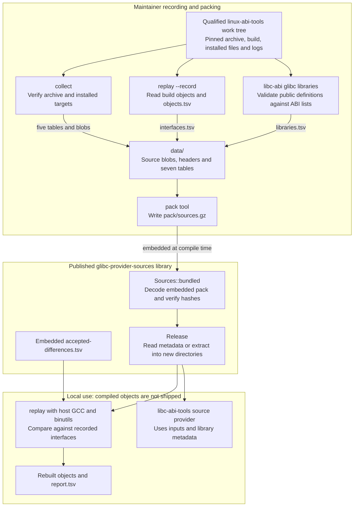

# Maintaining provider inputs

[README](../README.md) · [Data and extraction](DATA.md) · [Replay](REPLAY.md) ·
[Release plan](RELEASE-PLAN.md)

These commands change recorded data only when a data update is intended. Prose
changes do not require regeneration. Read [AGENTS.md](../AGENTS.md) first; never
hand-edit `data/` or add unreviewed replay exceptions. This guide covers updating
an existing release; adding a release also requires a separately reviewed change
to the crate's supported-release list and downstream qualification.

## Architecture and data flow

The arrows show implemented data flow, not proof that a fresh collection or
qualification run passed. The maintainer tools are unpublished; only the source
library, its pack and reviewed differences cross the package boundary.



Collection writes five tables; interface recording then reads the collected
`objects.tsv`, and library recording uses the matching ABI lists. Both add
metadata to `data/`; neither copies compiled object/library contents into the
pack. `pack --check` compares decoded pack contents with `data/`; rebuild replay
after repacking so it embeds the new inputs. Signature verification belongs to
the upstream provider pipeline, while the collector verifies the supplied
archive pin and pristine file bytes.

These boundaries follow the [collector](../collector/src/main.rs),
[interface recorder and replay](../collector/src/replay.rs),
[pack tool](../collector/src/pack.rs), and [library API](../src/lib.rs).
The [data reference](DATA.md) details classes and tables; the
[replay guide](REPLAY.md) defines comparisons and qualification limits.
This view traces existing [requirements](REQUIREMENTS.md#requirements)
GP-REQ-003–011 and GP-REQ-013–014; it adds no new contract.

The separate prebuilt implementation and `glibc-provider-binaries` remain
**Deferred pending legal review** before distributing compiled provider objects;
the compressed source pack is already in the source-only package. Tier 3
old-system qualification remains **Deferred**, not a routine maintenance blocker.
Object replay alone does not establish downstream application/link/Cargo or
old-system qualification; see the [roadmap boundaries](ROADMAP.md).

## Prerequisites and working directories

Run the commands below in the glibc-provider repository root, using Bash on
x86_64 Linux, Rust/Cargo 1.90 or newer, `tar` with xz support, `gzip`, GCC, and GNU
binutils (`ar`, `readelf`, assembler and linker). These workspace tools are
unpublished; select their binary explicitly with `--bin`.

Obtain a qualified linux-abi-tools provider work tree from its
[provider pipeline](https://github.com/rustcommons/linux-abi-tools/blob/main/docs/PROVIDERS.md).
For the chosen release it must retain the pinned `glibc-X.Y.tar.xz`,
`source-build/`, installed `source/`, `logs/source-build.log`, and
`logs/builder-defaults.txt`. The collector interprets build paths relative to
`/work` as recorded by that pipeline. An arbitrary host glibc installation is
not a replacement for the work tree.

Have a built `libc-abi` executable from the matching linux-abi-tools checkout;
its [README](https://github.com/rustcommons/linux-abi-tools#readme)
describes setup. Use matching bundled ABI lists, or supply `--data` with the
ABI-list directory for that release. Record the producer revision and compiler
versions used; see [DATA.md](DATA.md) for the required provenance.

Set paths for your existing work tree and executable, and replace the hash value
with the pinned archive SHA-256 from linux-abi-tools' corresponding
`examples/glibc-X.Y/INPUTS.toml`:

```sh
set -euo pipefail
RELEASE=2.28
WORK=/tmp/glibc-2.28-work
LIBC_ABI=/path/to/linux-abi-tools/target/release/libc-abi
ARCHIVE_SHA256='replace-with-the-pinned-64-character-sha256'
[[ "$ARCHIVE_SHA256" =~ ^[0-9a-f]{64}$ ]]
```

The hash check deliberately fails until a real pin is supplied. Do not derive a
new trusted pin merely by hashing whatever archive happens to be present.

## Collect and verify inputs

```sh
cargo run --release --locked --offline -p glibc-provider-collector \
  --bin glibc-provider-collect -- \
  --work "$WORK" --release "$RELEASE" --archive-sha256 "$ARCHIVE_SHA256"
cargo run --release --locked --offline -p glibc-provider-collector \
  --bin glibc-provider-collect -- \
  --work "$WORK" --release "$RELEASE" --archive-sha256 "$ARCHIVE_SHA256" --check
```

The collector writes blobs and its release tables; `--check` regenerates those
records in memory and compares them. It does not record the interface or library
tables below. `--root DIR` selects a different repository/data destination;
without it, the destination is the current directory.

## Record reference interfaces and libraries

```sh
cargo run --release --locked --offline -p glibc-provider-collector \
  --bin glibc-provider-replay -- --release "$RELEASE" --record "$WORK"

LIBRARY_TABLE=$(mktemp)
if "$LIBC_ABI" glibc libraries --release "$RELEASE" \
    --input "$WORK/source/lib64" > "$LIBRARY_TABLE"; then
  mv "$LIBRARY_TABLE" "data/$RELEASE/libraries.tsv"
else
  rm -f "$LIBRARY_TABLE"
  exit 1
fi
```

Replay `--record` reads the release's on-disk `objects.tsv` and build-tree
objects to write `interfaces.tsv`; it does not rebuild provider objects or require
`--compiler`/`--out`. `--root` selects the repository containing those tables.

`libc-abi glibc libraries` validates the installed libraries against ABI lists
and emits TSV on stdout; there is no `--output` option. The temporary file keeps
a failed command from truncating the existing table. If using external ABI lists,
add `--data /absolute/path/to/abi-lists` to that command. These tables describe
binaries but contain no copied binary code/data; see the [format](DATA.md).

## Pack, rebuild, and replay

After all tables have been recorded:

```sh
cargo run --release --locked --offline -p glibc-provider-collector \
  --bin glibc-provider-pack
cargo run --release --locked --offline -p glibc-provider-collector \
  --bin glibc-provider-pack -- --check
cargo build --release --locked --offline -p glibc-provider-collector \
  --bin glibc-provider-replay
./target/release/glibc-provider-replay \
  --release "$RELEASE" --compiler gcc --out "/tmp/replay-$RELEASE-candidate"
```

The last output directory must not already exist. Regenerating the pack does not
update an already compiled replay executable: rebuild it to embed the new pack.
The pack tool accepts `--root DIR`; its `--check` verifies decoded content equals
`data/`, not that compressed bytes are identical.

Use the [replay guide](REPLAY.md) for all-release qualification, direct build-tree
comparison, reports and compiler limitations. Review the diff and complete
[repository validation](../AGENTS.md#validation). Changed data or provider output
also needs downstream application, exhaustive-link and Cargo integration
qualification; passing object replay alone is insufficient. Publication and
package/MSRV/license gates are in the [release plan](RELEASE-PLAN.md), and require
separate authorization.
